# AZINCO — Project Requirements & Architecture Blueprint
## Part 2 — Architecture

| Field | Value |
|---|---|
| Document | AZINCO Blueprint, Part 2 of 5 |
| Version | 0.1 (DRAFT — awaiting owner approval) |
| Date | 2026-11-17 |
| Sources | Base Standard (BS) §7, §8, §11, §12; AZINCO Project Instructions (PI) §3, §5, §6, §9, §11; Part 1 requirement IDs |
| Owner decisions applied | DEC-12: platform base currency = **PKR** |
| Labels | **[Source]** Base Standard · **[PI]** Project Instructions · **[Recommended]** AZINCO design choice (to be confirmed by ADR) |

> Not production-ready. This is a target architecture. Payment providers, OCR/model vendors and hosting are **[SANDBOX]/[MOCK]** until ADRs are approved and Phase exit gates pass.

---

## 2.1 Architecture principles

| # | Principle | Consequence in design | Label |
|---|---|---|---|
| AP-1 | Models judge, code calculates, humans approve | LLM outputs are *proposals*; every figure is produced by the Ledger Service, Rule Engine or Calculators | [Source] BS §8.1 |
| AP-2 | Single writer for the books | Only the Ledger Service writes journals; only the Posting Agent may call it, and only to create **drafts**. Draft → Posted requires a human approval (R1) or a Tier A policy decision (P2+) | [Source] BS §7.7, §8.2; AMB-05 |
| AP-3 | Evidence first | Every journal line has FK to `document`, `extraction_field`, `rule_version`, `approval` | [Source] BS §8.4 |
| AP-4 | Tenant isolation by default | Every tenant table has `tenant_id` + PostgreSQL RLS; storage keys prefixed by tenant; per-tenant data key | [Source] BS §8.4, §12 |
| AP-5 | Jurisdiction as data | Rule packs are versioned JSON/YAML decision tables, loaded by the Rule Engine | [Source] BS §2.4, §8.2 |
| AP-6 | Everything is an event, every event is audited | Append-only hash-chained audit store; audit write failure blocks the action (fail-closed) | [Source] BS §7.3(15); fail-closed [Recommended] |
| AP-7 | Model-agnostic | All LLM calls through the Model Gateway; agents never import a vendor SDK directly | [Source] BS §8.2; [PI] §6 |
| AP-8 | Durable, resumable workflows | State graph checkpoints after every step; idempotency keys on every side-effect | [Source] BS §8.3 |
| AP-9 | Start as a modular monolith, split by need | One FastAPI codebase with strict module boundaries + separate worker and ledger processes; extract services only when load/ownership demands | [Recommended] (ADR-001) |
| AP-10 | Provider-agnostic payments | "Banking Channels" and international gateways behind one adapter interface | [PI] §3 |

---

## 2.2 Logical layers (BS §11.1)

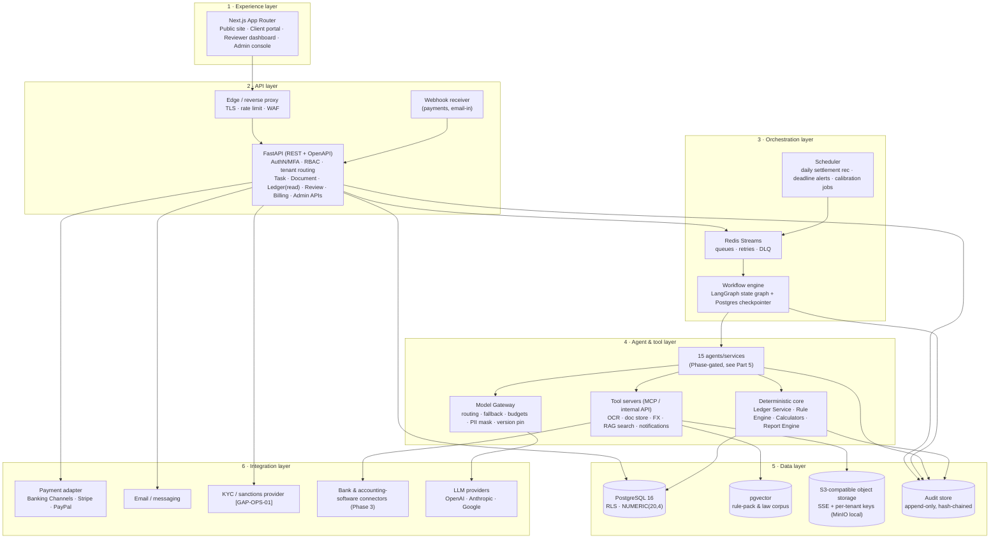

| Layer | Responsibility | Main tech | Label |
|---|---|---|---|
| Experience | All 14 interfaces of PI §10 | Next.js App Router, React, strict TS, Tailwind, Zod, TanStack Query | [PI] §9 |
| API | AuthN, MFA, RBAC, tenant context, validation, OpenAPI | FastAPI, Pydantic v2, SQLAlchemy 2 (async), Alembic | [Source] §11.2 |
| Orchestration | Order, parallelism, retries, checkpoints, human interrupts | LangGraph + Postgres checkpointer; Redis Streams workers | [Source] §8.2 |
| Agent & tool | Agents, gateway, tools, deterministic core | Python; OpenAI Agents SDK optional per agent behind gateway | [Source] §8.2 |
| Data | Structured, vector, object, audit | PostgreSQL 16 + pgvector; MinIO/S3 | [Source] §11.2 |
| Integration | Payments, email, KYC, connectors, models | Adapter pattern per category | [Source] §11.1; [PI] §3 |

---

## 2.3 Runtime containers (deployables)

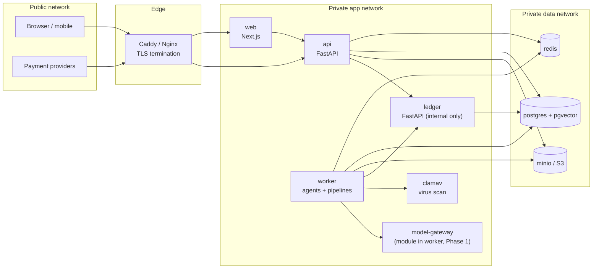

| Container | Purpose | Scales by | Notes |
|---|---|---|---|
| `web` | Next.js server (SSR + static) | Replicas | No secrets except public config; calls `api` only |
| `api` | Public REST API, webhooks | Replicas (stateless) | Sets tenant context per request |
| `worker` | Redis consumers: ingestion pipeline, LangGraph runs, scheduled jobs | Replicas per queue | Separate queues for OCR (heavy) and agent steps |
| `ledger` | Ledger Service — sole journal writer, internal network only | 1–N (DB is the lock) | BS §8.2 "small FastAPI service"; mTLS/service token [Recommended] |
| `model-gateway` | Python module in Phase 1; separate service when multi-language callers appear | — | ADR-004 |
| `clamav` | Virus scanning daemon | 1 | Every upload scanned before processing |
| `postgres` | System of record + pgvector + LangGraph checkpoints | Vertical; read replicas later | RLS enforced; app role is **not** owner/superuser |
| `redis` | Streams/queues, rate limits, short-lived cache | Vertical | No financial truth stored here |
| `minio` / S3 | Documents, reports, archives | Managed | SSE + tenant prefixes; versioning + object lock for archives |

---

## 2.4 Frontend architecture

```
apps/web/
  app/
    (public)/            # 1 public website & service overview
    (auth)/              # 2 registration, login, MFA
    (client)/            # 3–6, 11–12 client portal (tenant-scoped)
      onboarding/ dashboard/ tasks/[id]/ uploads/ billing/ downloads/ messages/
    (workspace)/         # 7–8 accounting & tax workspace (staff/reviewer)
    (review)/            # 9 Reviewer of Record dashboard
    (admin)/             # 10, 11(back-office), 13, 14 platform admin
  components/            # shared UI (Tailwind), document viewer, journal grid
  lib/api/               # generated typed client from OpenAPI + Zod schemas
  lib/auth/              # session, role guards
  middleware.ts          # route-group role checks (defence in depth; API is authority)
```

| Decision | Choice | Label |
|---|---|---|
| Data fetching | Server Components for reads; client components + TanStack Query for live views | [Recommended] |
| API contract | OpenAPI → generated TS client; Zod parse at boundary | [PI] §13 |
| Auth session | httpOnly, Secure, SameSite=strict cookie; CSRF token on mutations | [Recommended] ADR-006 |
| Live progress | Server-Sent Events from `api` (task progress, review queue counts) | [Recommended] |
| Money display | Server sends strings (decimal) + currency; formatting only in UI, never arithmetic | [PI] §13 |
| i18n | English + Urdu (RTL-aware layouts) | [Source] §7.3(12) |
| Banking Channels label | UI strings come from a single i18n key `payments.bankingChannels`; provider names never present in web bundle | [PI] §3 |
| Document viewer | PDF/image viewer with bbox highlight overlay fed by `extraction_field.source_region` | [Source] §7.5 |

---

## 2.5 Backend / API architecture

```
services/api/azinco/
  core/        config, security, db session (sets tenant GUC), errors, logging
  iam/         users, roles, MFA, sessions, reviewer licences
  tenancy/     tenants, entities, jurisdictions, policies
  onboarding/  KYC, acceptance, engagement letters
  tasks/       tasks, scope, quotes, state machine
  documents/   upload, scan, storage, signed URLs
  extraction/  read models of extractions
  ledger_read/ read-only views of journals, TB (writes go to ledger service)
  reconciliation/
  tax/         rule-pack registry, tax views
  review/      review items, approvals, four-eyes
  billing/     invoices, payments, payment adapter, webhooks, financial matrix
  comms/       messages, notifications
  audit/       audit writer client, explorer queries
  admin/       pricing, provider config, kill switch, feature flags
services/ledger/azinco_ledger/   # Ledger Service (separate deployable)
services/worker/azinco_worker/   # pipelines, agents, gateway, tools
packages/py-common/              # shared Pydantic schemas, money, ids, audit client
packages/rule-engine/            # deterministic rule evaluator + calculators
```

**Request lifecycle**

```mermaid
sequenceDiagram
    autonumber
    participant B as Browser
    participant A as api (FastAPI)
    participant P as PostgreSQL
    participant AU as Audit writer
    B->>A: HTTPS request + session cookie (+CSRF)
    A->>A: Authenticate · MFA level check · load roles
    A->>A: Pydantic validate input
    A->>P: BEGIN; SET LOCAL app.tenant_id = :tid; SET LOCAL app.user_id = :uid
    A->>A: RBAC policy check (role × action × resource)
    A->>P: Query / command (RLS filters rows)
    A->>AU: append audit_event (same transaction)
    A->>P: COMMIT
    A-->>B: Pydantic-validated response
```

| Concern | Design | Label |
|---|---|---|
| Tenant context | `SET LOCAL app.tenant_id` inside every transaction; RLS policies read `current_setting('app.tenant_id')`; missing setting ⇒ zero rows | [Recommended] ADR-003 |
| Platform staff | Staff act inside a tenant only via explicit "assignment" rows; cross-tenant read for admin views uses a separate, audited role with RLS `BYPASS` **not** granted — instead policy `tenant_id = ANY(assigned_tenants)` | [Recommended] |
| RBAC | Static permission table (role → action) + resource checks (assignment, ownership); enforced in API dependencies | [Source] §12 |
| Errors | RFC 9457 problem+json; no stack traces to clients | [Recommended] |
| Idempotency | `Idempotency-Key` header on POSTs that create money/state effects | [Source] §8.3 |
| Versioning | `/api/v1/...` | [Recommended] |

---

## 2.6 Agent orchestration with human-interrupt checkpoints

### 2.6.1 Task graph (Phase 1 shape)

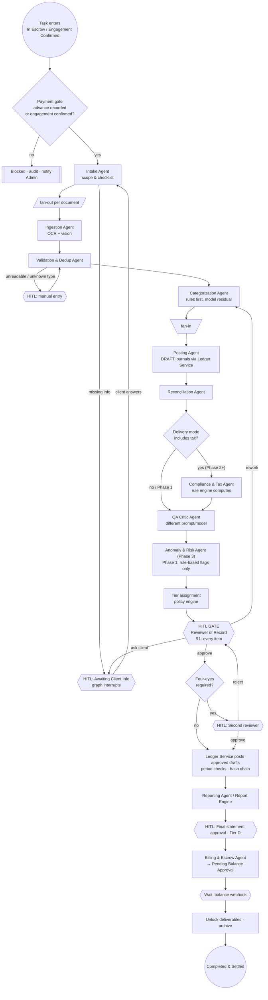

### 2.6.2 Orchestration design

| Element | Design | Label |
|---|---|---|
| Graph engine | LangGraph `StateGraph`; state = typed Pydantic `TaskRunState` (ids only, no document text) | [Source] §8.2; ADR-002 |
| Checkpointer | `PostgresSaver` in schema `orchestration`; checkpoint after every node | [Source] §8.3 |
| Human interrupts | `interrupt()` at every `{{HITL}}` node; resumed by API when a Reviewer/client action is committed (`Command(resume=...)`) | [Source] §7.5 |
| Payment gate | First node re-reads task state from DB (not from graph state) and refuses unless `In Escrow (Work Active)` or `Engagement Confirmed` | [Source] §7.3(1), PI §5.12 |
| Fan-out | `Send` API per document; concurrency limited per tenant | [Recommended] |
| Retries | Schema-invalid output → retry once → escalate (BS §8.3); tool errors → exponential backoff (max 3) → escalate | [Source] §8.3 |
| Escalation | Orchestrator escalates when an agent fails twice, confidence < threshold, or scope ambiguous → review item with reason | [Source] §7.3(1) |
| Limits | Per-step timeout; per-task token & cost budget; max graph steps; kill switch flag checked before every node | [Source] §7.7, §8.5 |
| Idempotency | Node side-effects keyed by `(task_id, node, input_hash)` | [Source] §8.3 |
| Agent runtime | Each agent = prompt (versioned) + allowed tools + output schema; implemented as a plain Python callable using the Gateway; OpenAI Agents SDK may wrap individual agents but never bypasses the Gateway | [PI] §6 |

### 2.6.3 Agent ↔ tool permissions (least privilege, BS §8.3)

| Agent | Allowed tools | Explicitly denied |
|---|---|---|
| Intake | `profile.read`, `packs.catalog.read`, `checklist.get`, `comms.draft` | ledger, payments |
| Ingestion | `doc.read_pages`, `ocr.run`, `gateway.vision_extract` | ledger, payments, comms |
| Validation | `calc.arith_check`, `dedup.search`, `master.lookup` | ledger write |
| Categorization | `rules.tenant_apply`, `vendor.history`, `gateway.classify`, `coa.read` | ledger write |
| Posting | `ledger.create_draft`, `fx.rate_for_date`, `calc.tax_split`, `calc.depreciation` | `ledger.post`, payments |
| Reconciliation | `ledger.read`, `match.run`, `statement.read` | ledger write |
| Compliance & Tax | `rule_engine.evaluate`, `rag.search`, `calendar.build` | filing, ledger write |
| Reporting | `report.render`, `ledger.read` (approved only), `gateway.commentary` | ledger write |
| QA Critic | `calc.*` re-perform, `ledger.read`, `policy.check` | all writes |
| Anomaly & Risk | `stats.detect`, `ledger.read` | all writes |
| Communication | `comms.draft`, `templates.render`; `comms.send` only for approved status templates | tax/legal/pricing send |
| Billing & Escrow | `billing.invoice_create`, `payments.status`, `task.transition(payment states)`, `deliverables.unlock` | refunds, price changes, payouts |
| Knowledge/RAG | `rag.search` (approved corpus only) | everything else |

`ledger.post` is callable only by the **API on behalf of a human approval** or (Phase 2+) by the policy engine for Tier A items — never by an agent tool.

---

## 2.7 Model Gateway

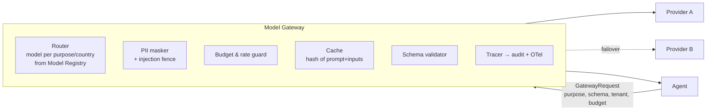

| Capability | Design | Label |
|---|---|---|
| Single interface | `gateway.complete(purpose, messages, output_schema, tenant_id, task_id)` | [Source] §8.2 |
| Routing | Model Registry table maps `(agent, purpose, jurisdiction)` → `(provider, model, version, prompt_version)` | [Source] §8.6 |
| Failover | Primary → secondary provider; if none, task waits in queue and client is notified | [Source] §8.5 |
| PII masking | Mask tax IDs, account numbers, CNIC-like IDs, emails, phones before prompt where not needed; reversible tokens kept server-side | [Source] §7.7 |
| Injection fence | Document text wrapped as quoted data with explicit "data, not instructions" system rule; tool calls validated against agent allow-list; output checked for policy breach | [Source] §7.7, §8.5 |
| Budget | Per-call, per-task, per-tenant, per-day caps; hard stop + escalation | [Source] §7.7 |
| Version pinning | Exact model version strings; change only via registry release | [Source] §8.6 |
| Output | Structured output → Pydantic validation → retry once → escalate | [Source] §8.3 |
| Logging | Prompt version, model version, token counts, cost, latency, masked I/O hash → audit + traces | [Source] §7.3(15) |
| No training | Provider contracts/settings with zero-retention / no-training where available | [Source] §12 |
| Phase 1 mode | **[MOCK]** provider available for tests and CI (deterministic fixtures) | [PI] §13 |

---

## 2.8 Deterministic core: Ledger Service, Rule Engine, Calculators

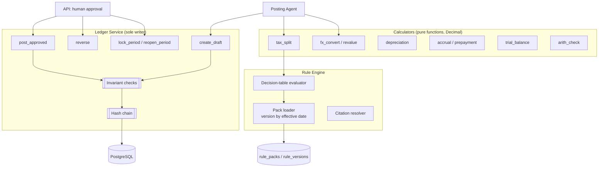

### Ledger invariants (enforced twice: service code **and** database) [Source BS §8.4]

| # | Invariant | Service check | Database enforcement |
|---|---|---|---|
| L1 | Σ debit = Σ credit per journal | Before insert | Deferred constraint trigger on `journal_lines` at COMMIT; `CHECK (debit >= 0 AND credit >= 0 AND (debit = 0) <> (credit = 0))` |
| L2 | Posted entries immutable | No update API | `BEFORE UPDATE/DELETE` trigger rejects when `status='posted'`; app role has no DELETE grant |
| L3 | Corrections = reversal | `reverse(journal_id)` creates mirror entry with `reverses_id` | FK `reverses_id` + unique (one reversal per journal) |
| L4 | Evidence on every line | Required fields | `NOT NULL` on `document_id`, `extraction_id` (or `evidence_type='manual_with_approval'`), `rule_version_id` where tax applies |
| L5 | Closed periods reject posting | Period lookup | Trigger checks `accounting_periods.status` |
| L6 | Approver recorded | Requires `approval_id` or `auto_rule_id` (P2+) | FK + CHECK one of them NOT NULL; approval actor must be human (trigger on `approvals`) |
| L7 | Money precision | `Decimal`, quantize per currency | `NUMERIC(20,4)`; currency `CHAR(3)` |
| L8 | Tenant scoped | tenant from context | RLS + `tenant_id` in every PK/FK composite |
| L9 | Tamper evidence | `row_hash = sha256(prev_hash ‖ canonical_row)` per tenant ledger | Unique sequence per tenant; nightly verifier job |

### Rule Engine [Source BS §6.6, §8.2]
- Pack = `{jurisdiction, layer (bookkeeping|tax), version, status (provisional|active|retired), effective_from, effective_to, owner, review_due, rules[]}`.
- Rule = decision table rows: conditions (doc type, tax code, entity type, registration status, dates, amounts) → outputs (rate reference, account mapping, withholding flag) + `citation {source_title, url_or_ref, section, retrieved_at}`.
- Evaluation is **pure**: `evaluate(pack_version, facts) -> result + rule_ids + citations`. Same input ⇒ same output (property-tested).
- **No rule content exists yet** — packs ship empty with schema + test harness only until the Reviewer supplies sourced content (GAP-TAX-01..05).

### Calculators [PI §5.2]
Pure Python functions over `Decimal`, no I/O, 100% branch-covered + Hypothesis property tests (e.g., `tax_split(gross) → net + tax == gross`; FX round-trip within rounding policy; depreciation never exceeds cost − residual).

---

## 2.9 Data layer

| Store | Holds | Isolation & protection | Label |
|---|---|---|---|
| PostgreSQL (schema `app`) | Tenants, users, tasks, documents meta, extractions, CoA, journals, reconciliations, approvals, billing | RLS on every tenant table; app connects as `azinco_app` (no BYPASSRLS, not owner); migrations as `azinco_migrator` | [Source] §8.4 |
| PostgreSQL (schema `ledger`) | journals, journal_lines, periods, hash chain | Only `azinco_ledger` role has INSERT; `azinco_app` SELECT only | [Recommended] |
| PostgreSQL (schema `audit`) | audit_events | INSERT-only role; no UPDATE/DELETE grants; hash chain; daily anchor hash exported to object lock bucket | [Source] §12 |
| PostgreSQL (schema `orchestration`) | LangGraph checkpoints | Tenant column + RLS; payloads contain ids only | [Recommended] |
| pgvector (`knowledge`) | Embeddings of approved rule-pack text, tax-law sources, internal policies; optional tenant document embeddings (tenant-scoped) | Shared corpus is non-client data; tenant embeddings carry `tenant_id` + RLS | [Source] §7.6 |
| Object storage | Raw uploads, normalised pages, reports, archives | Key = `t/{tenant_id}/{yyyy}/{doc_id}/...`; SSE with per-tenant data key (envelope encryption via KMS); bucket policies deny public; object lock on `archive` bucket | [Source] §8.4, §12 |
| Redis | Streams (jobs), rate limits, ephemeral cache | No PII payloads — job carries ids only; TLS + auth | [Recommended] |

Encryption keys: per-tenant **data encryption key** wrapped by a KMS master key (Vault Transit / cloud KMS) — ADR-007. Locally: MinIO SSE with a dev key **[MOCK]**.

---

## 2.10 Document ingestion / OCR pipeline with evidence links

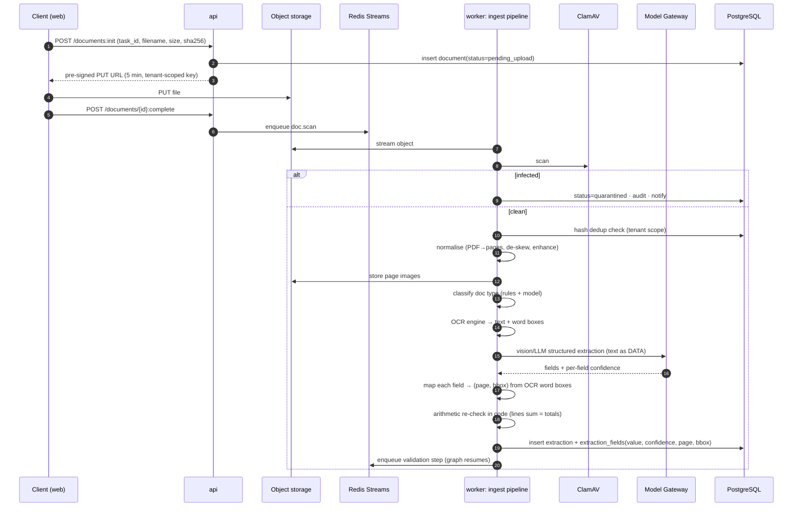

| Step | Deterministic or AI | Output stored | Label |
|---|---|---|---|
| Upload integrity | Code (sha256 client + server) | `documents.sha256` | [Source] §6.4(2) |
| Virus scan | Code (ClamAV) | `documents.scan_status` | [Source] §4.2(4) |
| Dedup (exact) | Code (hash) | duplicate link | [Source] §6.4(2) |
| Classification | Rules first, model fallback | `doc_type`, confidence | [Source] §7.3(3) |
| OCR | OCR engine (DEC-09) | page text + word boxes | [Source] §8.1 |
| Field extraction | Multimodal model via Gateway | fields + confidence | [Source] §7.3(3) |
| Evidence link | Code (match values to OCR boxes) | `page_no`, `bbox`, `source_text` per field | [PI] §5.3 |
| Arithmetic check | Code | `validation_results` | [Source] §8.1 |
| Failure | → human manual entry; case added to golden set | review item | [Source] §8.5 |

---

## 2.11 Jurisdiction rule-pack versioning

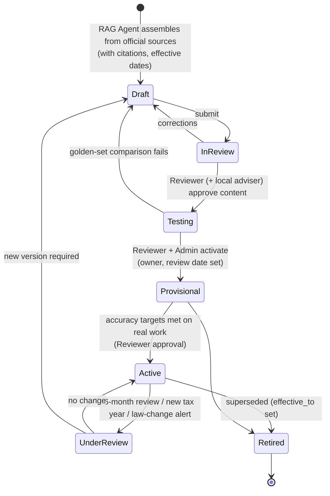

| Rule | Design | Label |
|---|---|---|
| Two layers | Separate versions for Layer 1 (bookkeeping/reporting) and Layer 2 (tax) | [Source] §6.6 |
| Immutability | A published version is never edited; changes create a new version | [Recommended] |
| Effective dating | Engine selects version where `effective_from ≤ transaction_date < effective_to` | [Source] §6.6 |
| Traceability | Every journal line and tax result stores `rule_version_id` + rule ids; reports show pack version + citations | [Source] §8.4; [PI] §7 |
| Autonomy link | `Provisional` ⇒ all tax outputs and Tier B items mandatory review | [Source] §6.6 |
| Storage | Pack source as YAML in a governed repo folder `rule-packs/{cc}/{layer}/{version}.yaml` + DB registry row with content hash | [Recommended] ADR-008 |
| Tests | Each pack ships with rule-level test cases; CI blocks activation if any fail | [Source] §8.2 |
| Status in UI | Rule-pack manager shows status, owner, review due date, approvals | [Source] §10.2 |

---

## 2.12 Reviewer approval workflow

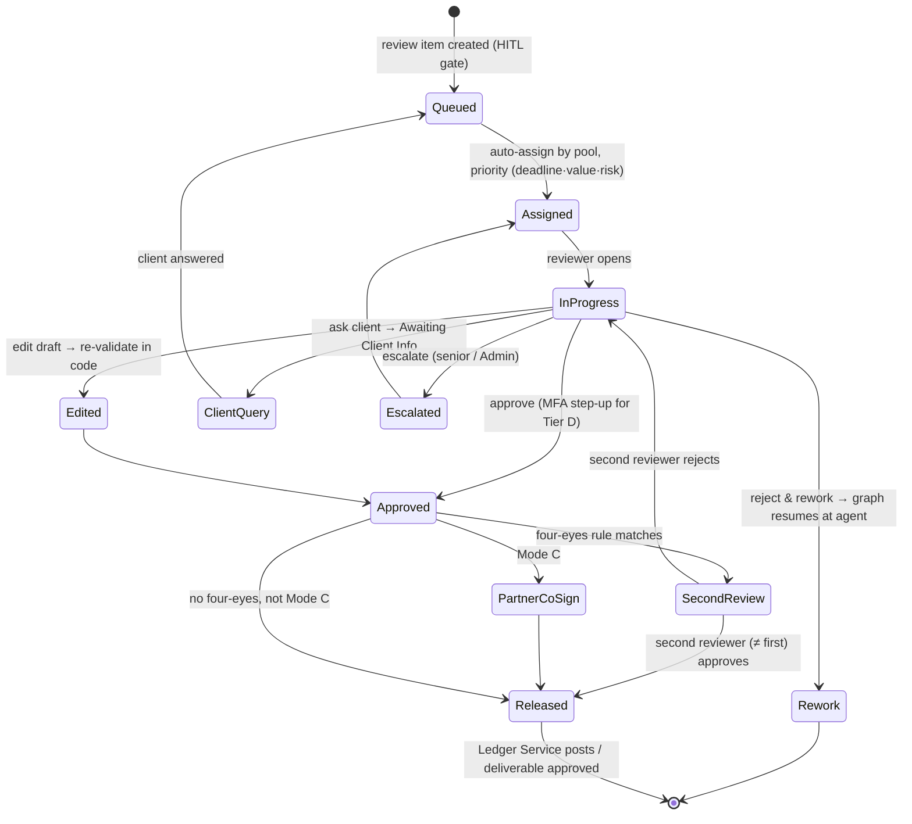

| Control | Design | Label |
|---|---|---|
| Who can approve | Human user, REVIEWER role, **valid licence for the engagement's jurisdiction** at approval time | [Source] §8.7, §9.6 |
| What is recorded | `approvals(reviewer_id, reviewer_name, licence_id, licence_status_snapshot, jurisdiction, item_type, item_id, item_hash, decision, comment, approved_at, mfa_method)` | [Source] §8.7 |
| Agent block | API endpoint requires interactive human session; DB trigger rejects approvals where actor type ≠ `human` | [Source] §8.7; DB [Recommended] |
| Four-eyes | Rule evaluated per engagement (value, risk score, new client, cross-border, Provisional pack); second approver must differ | [Source] §8.7; triggers GAP-REV-01 |
| Item hash | Approval binds to SHA-256 of the exact draft content; any later change invalidates approval | [Recommended] |
| Feedback | Every edit/reject stored as labelled feedback (agent output vs final) | [Source] §7.5 |
| Step-up MFA | Re-authenticate for Tier D approvals (final statements, tax outputs, period close, re-open) | [Recommended] |

---

## 2.13 Banking Channels / payment adapter and webhook flow

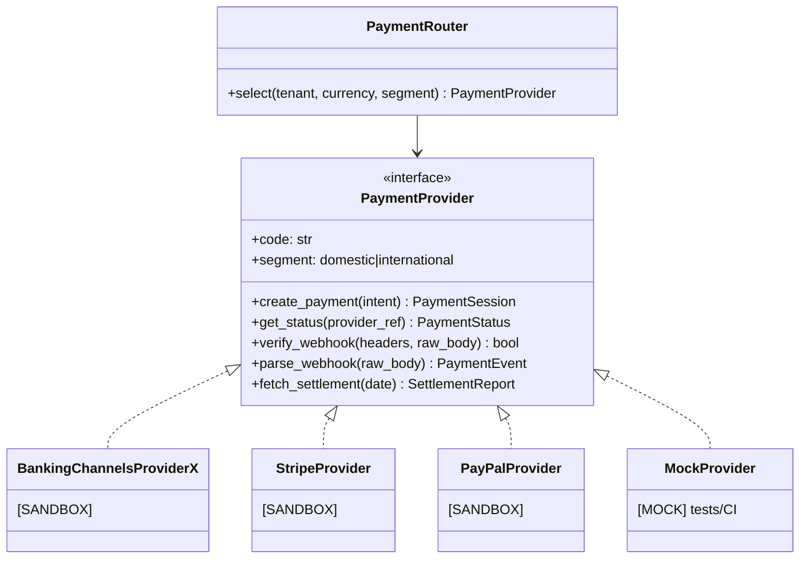

- Client sees **"Banking Channels"** (domestic) or **"Card / PayPal"** (international). Provider `code` is internal and appears only in Admin back-office and server logs. [PI §3]
- Refunds are **not** in the agent-facing interface; refunds are a human-initiated Admin action with approval. [Source BS §7.7]

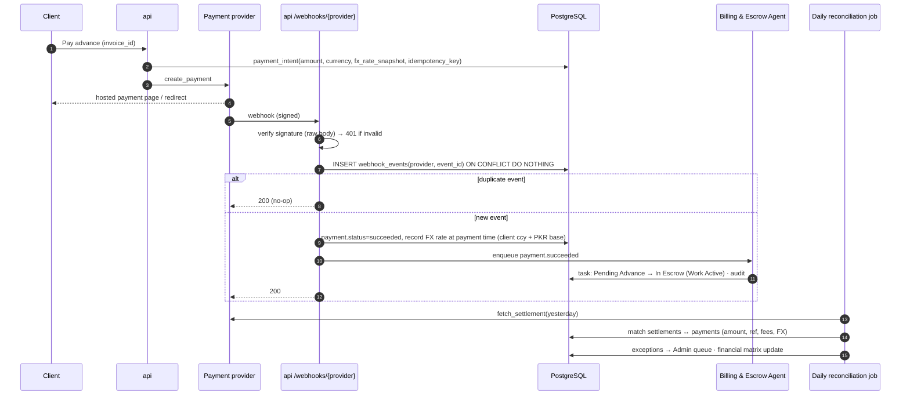

| Control | Design | Label |
|---|---|---|
| Signature | Verify on raw request body with provider secret from secrets manager | [Source] §5.2 |
| Idempotency | Unique `(provider, event_id)`; state transitions are conditional updates (`WHERE state = expected`) | [Source] §5.2, §8.3 |
| Daily reconciliation | Scheduled job, exceptions to Admin, results in financial matrix (fees, FX differences) | [Source] §5.2, §5.4 |
| FX | `fx_rate`, `rate_source`, `rate_timestamp` stored with every payment; amounts stored in client currency and PKR | [Source] §5.1; DEC-12 |
| Funds handling | `funds_handling` read from tenant/jurisdiction/service config; Option B code path behind feature flag **OFF** | [Source] §5.3; [PI] §3 |
| PCI | Hosted pages / redirects only; platform never sees card data | [Source] §12 |

---

## 2.14 Audit log

| Aspect | Design | Label |
|---|---|---|
| Event shape | `audit_events(id, tenant_id, seq, occurred_at, actor_type{human,agent,system}, actor_id, action, resource_type, resource_id, task_id, request_id, trace_id, model, model_version, prompt_version, tool, input_hash, output_hash, confidence, before_hash, after_hash, details jsonb (masked), prev_hash, row_hash)` | [Source] §7.3(15) |
| Append-only | INSERT-only DB role; triggers block UPDATE/DELETE; no ORM model with update methods | [Source] §12 |
| Hash chain | `row_hash = sha256(prev_hash ‖ canonical_json(event))`, sequence per tenant (+ platform stream) | [Source] §8.2 |
| Anchoring | Daily: last hash per tenant written to object-lock bucket; verifier job recomputes chain and alerts on mismatch | [Recommended] |
| Transactional | Business change and its audit event commit in the same DB transaction (outbox pattern for cross-service) | [Recommended] |
| Large payloads | Prompts/outputs stored masked in object storage; event keeps hash + pointer | [Source] §7.7 |
| Explorer | Trace any figure: report line → journal line → extraction field → document page/bbox → rule version → approval → actor | [Source] §10.2 |

---

## 2.15 Observability

| Signal | Design | Label |
|---|---|---|
| Traces | OpenTelemetry SDK in web (server), api, worker, ledger; one trace per task run; spans per agent node and tool call | [Source] §8.2 |
| Logs | Structured JSON (structlog), `request_id`, `trace_id`, `tenant_id` (hashed in shared sinks), PII masking filter | [Source] §7.7 |
| Metrics | Prometheus: latency, error rate, queue depth, OCR time, cost per doc/task, tokens, tier distribution, reviewer queue age | [Source] §7.8 |
| AI evaluation | Golden-set regression job per release; calibration gap dashboards (Phase 2) | [Source] §7.8 |
| Dashboards | Grafana (local: Docker); Agent Operations view in Admin UI reads the same metrics | [Source] §10.2 |
| Alerts | SLO burn (availability 99.5%), audit-chain mismatch, webhook signature failures, settlement exceptions, budget breach, quality drop → auto-tighten | [Source] §13, §8.5 |

---

## 2.16 Deployment, environments and CI/CD

### Environments
| Env | Purpose | Data | Payments | Models |
|---|---|---|---|---|
| `local` | Developer Docker Compose | Synthetic only | **[MOCK]** provider | **[MOCK]** + optional real keys from `.env` |
| `ci` | GitHub Actions ephemeral services | Synthetic fixtures | [MOCK] | [MOCK] |
| `dev` | Shared integration | Synthetic | **[SANDBOX]** | Real (budget-capped) |
| `staging` | Pre-prod, shadow tests, golden set | Synthetic + consented anonymised | [SANDBOX] | Real |
| `prod` | Live (only after Phase exit gates) | Client data | Live (after ADR + legal) | Real |

### Local Docker Compose (Phase 0)
`postgres (pgvector/pgvector:pg16)`, `redis:7`, `minio`, `clamav`, `api`, `worker`, `ledger`, `web`, `mailpit` (dev email), optional `otel-collector` + `grafana`.

### Repository layout (monorepo) [Recommended, ADR-001]
```
azinco/
  apps/web/                     Next.js
  services/api/                 FastAPI public API
  services/ledger/              Ledger Service
  services/worker/              pipelines, agents, gateway
  packages/py-common/           shared schemas, money, audit client
  packages/rule-engine/         rule evaluator + calculators
  rule-packs/                   governed pack sources (empty until sourced)
  infra/docker/                 Dockerfiles, compose
  infra/ci/                     scripts
  docs/blueprint/ docs/adr/     this blueprint + ADRs
  tests/e2e/                    Playwright
  .github/workflows/            CI
  .env.example                  placeholders only
```

### CI/CD pipeline (GitHub Actions)
```mermaid
flowchart LR
    PR[Pull request] --> L[Lint & format<br/>ruff · eslint · prettier]
    L --> T[Typecheck<br/>mypy strict · tsc strict]
    T --> U[Unit + property tests<br/>pytest · hypothesis · vitest]
    U --> I[Integration tests<br/>Postgres+Redis+MinIO services<br/>RLS isolation suite]
    I --> S[Security<br/>bandit · pip-audit · npm audit<br/>gitleaks · trivy image scan]
    S --> M[Migrations check<br/>alembic upgrade/downgrade]
    M --> B[Build images]
    B --> G{main?}
    G -- yes --> D1[Deploy dev]
    D1 --> E[E2E Playwright + golden-set smoke]
    E --> D2[Manual approval → staging]
    D2 --> D3[Manual approval + phase gate → prod]
```

| Gate | Blocks merge/deploy when | Label |
|---|---|---|
| Ledger property tests | Any invariant counter-example | [PI] §13 |
| RLS isolation suite | Any cross-tenant read/write succeeds | [Source] §14 |
| Secrets scan | Any secret detected | [PI] §11 |
| Golden-set regression | Accuracy below phase target (prompt/model/pack changes) | [Source] §7.8, §8.6 |
| Prod deploy | Phase exit gate not signed (golden set + Reviewer + security review) | [Source] §15 |

---

## 2.17 End-to-end data flow — one complete task

Scenario: Pakistani retail client, monthly bookkeeping, Model 1 (advance + balance), Option A, Mode B, Release 1 (every item reviewed).

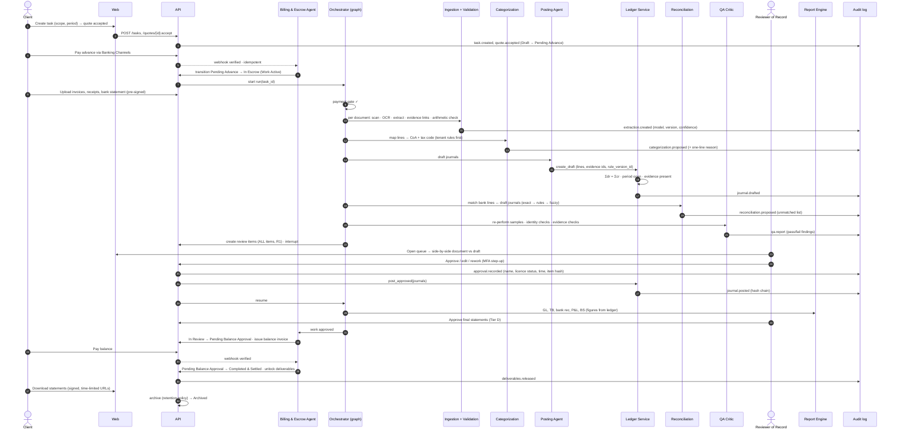

| Step | What happens | Who/what decides figures | Gate |
|---|---|---|---|
| 1 Upload | Pre-signed upload, scan, hash dedup | Code | Task must be *In Escrow* to process |
| 2 Extraction | OCR + model fields with confidence + bbox | Model reads; code checks arithmetic | Low confidence → flagged |
| 3 Journal draft | Account/tax code proposed; draft created | Rule engine (tax split), calculators (FX), ledger service (balance) | Draft only |
| 4 Reconciliation | Matching + unmatched list | Matching engine (code) | Tolerance escalation |
| 5 QA | Independent re-check | Code re-performance + critic model | Findings attached |
| 6 Review | Reviewer side-by-side | Human | Every item in R1; four-eyes if triggered |
| 7 Approval → Post | Approved drafts posted, hash-chained | Ledger Service | Human approval recorded |
| 8 Balance | Balance invoice paid | Gateway + webhook | Signature + idempotency |
| 9 Delivery | Deliverables unlocked, archived | System | Only after settlement |

---

## 2.18 Proposed ADRs (to be written in Phase 0)

| ADR | Title | Proposed decision | Status |
|---|---|---|---|
| ADR-001 | Repo & service topology | Monorepo; modular-monolith API + separate `ledger` and `worker` deployables | Proposed |
| ADR-002 | Orchestration framework | LangGraph state graph + Postgres checkpointer; OpenAI Agents SDK optional per agent behind Gateway | Proposed |
| ADR-003 | Tenant isolation | Shared DB, shared schema, `tenant_id` + RLS via `SET LOCAL`; non-owner app role; isolation test suite in CI | Proposed |
| ADR-004 | Model Gateway | In-process module (Phase 1) with provider adapters + registry; extract later | Proposed |
| ADR-005 | Queue | Redis Streams with consumer groups + DLQ; Temporal reconsidered if long-running durability needs grow | Proposed |
| ADR-006 | Authentication | FastAPI-native auth (Argon2id, TOTP MFA, server sessions in DB, httpOnly cookies) vs managed IdP — **owner input requested (DEC-11)** | Proposed |
| ADR-007 | Encryption & keys | Envelope encryption, per-tenant DEK, KMS/Vault master key | Proposed |
| ADR-008 | Rule-pack format | YAML decision tables in governed folder + DB registry with content hash | Proposed |
| ADR-009 | Money & FX | `Decimal` everywhere, `NUMERIC(20,4)`, base currency **PKR**, per-currency rounding policy | Proposed (DEC-12 resolved) |
| ADR-010 | OCR engine | Spike: open-source (e.g., PaddleOCR/Tesseract) vs cloud OCR on synthetic set — decide by accuracy/cost | Proposed (DEC-09) |
| ADR-011 | Payment adapter | Provider-agnostic interface; "Banking Channels" naming; Mock + Sandbox providers first | Proposed |
| ADR-012 | Audit store | Postgres append-only hash-chained table + daily anchoring to object lock | Proposed |
| ADR-013 | Hosting & region | To decide (DEC-10) | Open |

---

## Part 2 — Summary of coverage

| # | Item | Status | Notes |
|---|---|---|---|
| 2.1 | Architecture principles | Done | 10 principles, sourced |
| 2.2 | Logical layers (§11.1) | Done | Mermaid layer diagram |
| 2.3 | Runtime containers | Done | 9 containers incl. separate ledger service |
| 2.4 | Frontend | Done | Route groups map to PI §10 interfaces |
| 2.5 | Backend/API | Done | Module layout, tenant context, RBAC, idempotency |
| 2.6 | Orchestration & HITL interrupts | Done | Task graph, payment gate, tool permissions |
| 2.7 | Model Gateway | Done | Routing, failover, masking, budgets, [MOCK] provider |
| 2.8 | Ledger Service, Rule Engine, Calculators | Done | 9 invariants enforced in code + DB |
| 2.9 | Data layer | Done | RLS, schemas, pgvector, object storage, Redis |
| 2.10 | Ingestion/OCR pipeline | Done | Evidence links (page + bbox) |
| 2.11 | Rule-pack versioning | Done | Lifecycle incl. Provisional/Active |
| 2.12 | Reviewer workflow | Done | Four-eyes, Mode C, item-hash binding |
| 2.13 | Banking Channels adapter & webhooks | Done | Signature, idempotency, daily rec, FX in PKR |
| 2.14 | Audit log | Done | Hash chain + anchoring |
| 2.15 | Observability | Done | OTel, metrics, alerts |
| 2.16 | Deployment & CI/CD | Done | 5 environments, CI gates |
| 2.17 | End-to-end task flow | Done | Upload → delivery sequence |
| 2.18 | ADR list | Done | 13 ADRs proposed |
