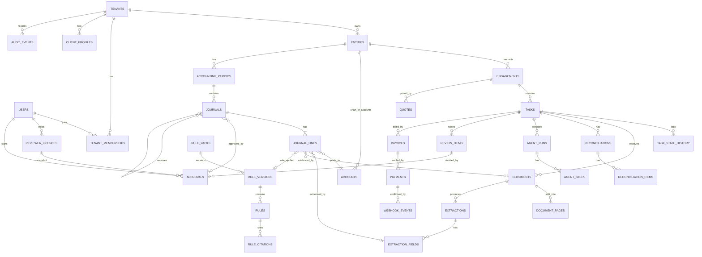

# AZINCO — Project Requirements & Architecture Blueprint
## Part 3 — Data and API Design (summary level)

| Field | Value |
|---|---|
| Document | AZINCO Blueprint, Part 3 of 5 |
| Version | 0.1 (DRAFT — awaiting owner approval) |
| Date | 2026-11-17 |
| Sources | Base Standard (BS) §4.3, §5, §6.4, §7.4, §8.4, §12; Project Instructions (PI) §3, §5, §13; Parts 1–2 |
| Detail level | Summary. Full column lists, indexes and migrations are produced per build step (Alembic) |
| Labels | **[Source]** · **[PI]** · **[Recommended]** |

> Conventions [PI §13]: all money `NUMERIC(20,4)` + `currency CHAR(3)`; ids `UUID` (v7, time-ordered) [Recommended]; timestamps `TIMESTAMPTZ` (UTC); every tenant-owned table has `tenant_id UUID NOT NULL` + RLS; enums as PostgreSQL enums or check constraints; base currency **PKR** (DEC-12).

---

## 3.1 Schemas

| Schema | Contents | Writer role | Label |
|---|---|---|---|
| `app` | Tenancy, IAM, onboarding, tasks, documents, extractions, CoA, reconciliations, reviews, billing | `azinco_app` | [Recommended] |
| `ledger` | Periods, journals, journal lines, ledger hash chain | `azinco_ledger` only (INSERT); `azinco_app` SELECT | [Source] BS §8.2 |
| `rules` | Rule packs, versions, rules, citations, confidence policies | `azinco_app` (admin endpoints) | [Source] BS §6.6, §7.4 |
| `agents` | Model registry, prompts, agent runs, steps, feedback | `azinco_worker` | [Source] BS §8.6, §7.5 |
| `audit` | Audit events (append-only) | `azinco_audit` INSERT only | [Source] BS §12 |
| `orchestration` | LangGraph checkpoints | `azinco_worker` | [Recommended] |
| `knowledge` | RAG documents + pgvector embeddings | `azinco_worker` | [Source] BS §7.6 |

Roles: `azinco_migrator` (owner, used only by Alembic), `azinco_app`, `azinco_worker`, `azinco_ledger`, `azinco_audit`, `azinco_readonly` (reporting). **None** has `BYPASSRLS`; app roles are not table owners, so RLS is always applied (`FORCE ROW LEVEL SECURITY` set on every tenant table) [Recommended, ADR-003].

---

## 3.2 ER diagram (core)

---

## 3.3 Core tables

### Tenancy & IAM
| Table | Key columns | Notes | Label |
|---|---|---|---|
| `tenants` | id, name, status (`onboarding/active/suspended/offboarded`), home_jurisdiction, base_currency (default `PKR`), funds_handling (`ledger/segregated`, default `ledger`), data_region, kill_switch bool, created_at | One tenant = one client organisation ("tenant vault") | [Source] BS §4.1, §5.3 |
| `entities` | id, tenant_id, legal_name, entity_type, size_class, jurisdiction, tax_registrations jsonb (masked), fiscal_year_end, accounting_method (`cash/accrual`), framework, functional_currency, business_type (`shop/mall/factory/corporate/other`), cut_over_date | A tenant can hold several entities (corporate groups) | [Source] BS §4.2(1), §6.1, §6.9 |
| `users` | id, email (unique, citext), display_name, password_hash (Argon2id), mfa_enabled, mfa_secret_enc, user_type (`client/staff/system`), locale (`en/ur`), status | Platform-level identity | [Source] BS §12 |
| `tenant_memberships` | tenant_id, user_id, role (`client_owner/client_staff/support_ops/reviewer/second_reviewer/local_partner/auditor`), granted_by, expires_at | Staff access to a tenant only via membership/assignment; auditor memberships expire | [Source] BS §3.1; [Recommended] |
| `platform_roles` | user_id, role (`platform_admin/ai_engineer/compliance_officer`) | Not tenant-scoped | [Recommended] |
| `reviewer_licences` | id, user_id, body, licence_ref (masked), jurisdictions[], status (`verified/pending/expired/revoked`), valid_from, valid_to, evidence_document_id, verified_by | Checked at every approval | [Source] BS §8.7, §9.6 |
| `sessions` | id, user_id, created_at, expires_at, mfa_level, ip_hash, user_agent_hash, revoked_at | Server-side sessions (ADR-006) | [Recommended] |

### Onboarding & engagement
| Table | Key columns | Label |
|---|---|---|
| `client_profiles` | tenant_id, kyc_status, sanctions_status, pep_status, conflict_check_status, risk_rating, acceptance_decision, decided_by, decided_at | [Source] BS §9.6 |
| `engagements` | id, tenant_id, entity_id, services[], period_from, period_to, delivery_mode (`A/B/C/D`), payment_model (`advance_balance/pay_on_completion/retainer`), funds_handling, advance_pct, credit_limit, letter_document_id, signed_at, signed_by, status | [Source] BS §3.3, §9.1, §9.3 |
| `jurisdictions` | code (e.g. `PK`, `GB`), name, allowed_modes[], filing_enabled bool (**default false**), option_b_enabled bool (**default false**), approvals jsonb | [PI] §8; [Source] BS §5.3 |
| `accounting_policies` | entity_id, inventory_method, capitalisation_threshold, depreciation_rules jsonb, fx_rate_source, revaluation_rule, revenue_policy, recon_tolerance | [Source] BS §6.10 |

### Tasks
| Table | Key columns | Label |
|---|---|---|
| `tasks` | id, tenant_id, engagement_id, title, services[], period, state (enum §1.8.1 incl. `engagement_confirmed`, `pending_payment`), deadline, clock_paused_at, priority, created_by | [Source] BS §4.3 |
| `task_state_history` | task_id, from_state, to_state, actor_type, actor_id, reason, at | [Source] BS §4.3 |
| `change_requests` | id, task_id, description, quote_id, status | [Source] BS §9.4 |

State transitions are enforced by a **transition table in code + a DB trigger** that rejects any `(from, to)` pair not in the allowed set [Recommended].

### Documents & extraction
| Table | Key columns | Label |
|---|---|---|
| `documents` | id, tenant_id, task_id, storage_key, original_filename, mime, size_bytes, sha256, scan_status (`pending/clean/quarantined`), doc_type, doc_type_confidence, language, duplicate_of, source (`upload/email/camera/import`), uploaded_by | [Source] BS §4.2(4), §6.3 |
| `document_pages` | document_id, page_no, image_key, width, height, ocr_text_key | [Recommended] |
| `extractions` | id, tenant_id, document_id, model, model_version, prompt_version, status, overall_confidence, totals_check (`pass/fail`), created_at | [Source] BS §7.3(3) |
| `extraction_fields` | id, extraction_id, field_path (e.g. `lines[2].amount`), value_text, value_decimal NUMERIC(20,4), currency, confidence, page_no, bbox (x,y,w,h normalised), source_text | Evidence link (document, page, field) [PI §5.3] |
| `validation_results` | extraction_id, check_code, result, details | [Source] BS §7.3(4) |

### Chart of accounts & ledger (schema `ledger` for journals)
| Table | Key columns | Label |
|---|---|---|
| `coa_templates` | id, jurisdiction, business_type, version, accounts jsonb | [Source] BS §6.2 |
| `accounts` | id, tenant_id, entity_id, code, name, class (`asset/liability/equity/revenue/cogs/opex/other/tax`), parent_id, is_suspense, currency, active | [Source] BS §6.2, §6.4(5) |
| `accounting_periods` | id, tenant_id, entity_id, start, end, status (`open/locked/reopened/migrated`), locked_by, locked_at | [Source] BS §6.5, §6.9 |
| `journals` | id, tenant_id, entity_id, period_id, journal_no (per entity seq), date, description, status (`draft/posted/reversed`), source (`agent/manual/opening/reversal`), reverses_id, approval_id, auto_rule_id, task_id, created_by_actor, content_hash, prev_hash, row_hash, posted_at | [Source] BS §8.4 |
| `journal_lines` | id, journal_id, tenant_id, line_no, account_id, debit, credit, currency, fx_rate, base_debit, base_credit (PKR), tax_code, document_id, extraction_field_id, rule_version_id, evidence_type (`extraction/manual_with_approval/opening/system_calc`), memo | [Source] BS §6.4(1) |

DB constraints: line `CHECK ((debit>0 AND credit=0) OR (credit>0 AND debit=0))`; deferred constraint trigger checks `SUM(debit)=SUM(credit)` and `SUM(base_debit)=SUM(base_credit)` per journal at commit; update/delete trigger blocks posted rows; period-status trigger [Source BS §8.4].

### Reconciliation
| Table | Key columns | Label |
|---|---|---|
| `reconciliations` | id, tenant_id, task_id, type (`bank/card/ar/ap/inventory/tax/payroll`), account_id, statement_document_id, period, statement_balance, ledger_balance, difference, tolerance, status | [Source] BS §6.5, §7.3(7) |
| `reconciliation_items` | id, reconciliation_id, statement_line_ref, journal_line_id, match_method (`exact/rule/fuzzy/manual`), match_score, status (`matched/unmatched/explained`), explanation | [Source] BS §7.3(7) |

### Rules & policy (schema `rules`)
| Table | Key columns | Label |
|---|---|---|
| `rule_packs` | id, jurisdiction, layer (`bookkeeping/tax`), name, owner_user_id | [Source] BS §6.6 |
| `rule_versions` | id, pack_id, version, status (`draft/in_review/testing/provisional/active/under_review/retired`), effective_from, effective_to, content_hash, source_path, review_due, approved_by[], approved_at | [Source] BS §6.6 |
| `rules` | id, version_id, rule_code, kind, conditions jsonb, outputs jsonb | [Source] BS §8.2 |
| `rule_citations` | rule_id, source_title, reference, section, retrieved_at | [Source] BS §6.6 |
| `confidence_policies` | id, level (`platform/jurisdiction/doc_type/tenant/agent`), scope_key, t_auto, t_floor, v_max jsonb (per currency), sample_rate_b, audit_rate_a, n_min, version, status, approved_by | Defaults 0.98/0.95/20%/5%/200 [Source] BS §7.4 |

### Agents (schema `agents`)
| Table | Key columns | Label |
|---|---|---|
| `model_registry` | id, agent, purpose, jurisdiction, provider, model, model_version, prompt_version, status, released_at, approved_by | [Source] BS §8.6 |
| `prompts` | id, agent, version, template_hash, storage_key | [Source] BS §8.6 |
| `agent_runs` | id, tenant_id, task_id, graph_version, status, started_at, ended_at, cost_total, tokens_total, kill_reason | [Source] BS §8.3 |
| `agent_steps` | id, run_id, agent, node, attempt, idempotency_key (unique), input_hash, output_hash, output jsonb (masked), confidence, calibrated_confidence, tier, model_registry_id, tool_calls jsonb, cost, latency_ms, status, error | [Source] BS §8.3 |
| `feedback_labels` | id, tenant_id, agent_step_id, outcome (`accepted/edited/rejected`), corrected_output jsonb, reviewer_id | [Source] BS §7.4, §7.5 |
| `tenant_rules` | id, tenant_id, kind (`vendor_mapping/categorisation`), match jsonb, output jsonb, source_feedback_id | Tenant-only learning [Source] BS §7.3(5) |

### Review & approvals
| Table | Key columns | Label |
|---|---|---|
| `review_items` | id, tenant_id, task_id, item_type (`extraction/categorisation/journal/reconciliation/tax/statement/period_close/reopen/opening_balance/message`), item_ref, tier (`A/B/C/D`), reason_codes[], risk_score, value_base, priority, due_at, assigned_to, status (§2.12), requires_four_eyes, requires_partner | [Source] BS §7.5, §8.7 |
| `approvals` | id, tenant_id, review_item_id, step (`primary/second/partner`), decision (`approved/rejected/edited/rework/escalated`), reviewer_user_id, reviewer_name, licence_id, licence_status_snapshot, jurisdiction, item_hash, comment, mfa_method, actor_type (CHECK = `human`), decided_at | [Source] BS §8.7 |

Constraint: unique `(review_item_id, step)`; trigger ensures `second` approver ≠ `primary` approver.

### Billing & payments
| Table | Key columns | Label |
|---|---|---|
| `quotes` | id, tenant_id, engagement_id, pricing_model, lines jsonb, subtotal, currency, valid_until, status, requote_triggers | [Source] BS §9.2 |
| `invoices` | id, tenant_id, task_id, kind (`advance/balance/full/retainer/change`), amount, currency, amount_base (PKR), status (`draft/issued/paid/overdue/void`), due_at | [Source] BS §7.3(13) |
| `payment_providers` | id, code (internal), segment (`domestic/international`), display_group (`banking_channels/card_paypal`), enabled, sandbox, config_ref (secret manager key) | Provider names only here, Admin-only [PI] §3 |
| `payments` | id, tenant_id, invoice_id, provider_id, provider_ref, idempotency_key (unique), amount, currency, fx_rate, fx_source, fx_at, amount_base (PKR), fees, status, settled_at | [Source] BS §5.1, §5.2 |
| `webhook_events` | id, provider_id, event_id, received_at, signature_valid, payload_key, processed_at, unique(provider_id, event_id) | [Source] BS §5.2 |
| `settlement_runs` | id, provider_id, date, matched, exceptions, report_key | [Source] BS §5.2 |
| `refunds` | id, payment_id, amount, reason, requested_by, approved_by, status | Human-only [Source] BS §7.7 |

`payment_providers` and webhook tables are **platform-level** (no tenant RLS) and readable only by Admin endpoints.

### Communication & audit
| Table | Key columns | Label |
|---|---|---|
| `messages` | id, tenant_id, task_id, thread_id, author_type, author_id, body, language, status (`draft/pending_approval/sent`), requires_approval, approved_by | [Source] BS §7.3(12) |
| `notifications` | id, user_id, kind, payload, read_at | [Recommended] |
| `audit.audit_events` | see Part 2 §2.14 | [Source] BS §7.3(15) |

---

## 3.4 Tenant isolation strategy

| Layer | Mechanism | Label |
|---|---|---|
| Model | Shared database, shared schema, `tenant_id` column on every tenant table; composite FKs `(tenant_id, id)` so a row can only reference rows of the same tenant | [Recommended] ADR-003 |
| Database | `ENABLE` + `FORCE ROW LEVEL SECURITY`; policy `USING (tenant_id = current_setting('app.tenant_id')::uuid)` and same `WITH CHECK`; missing setting raises error ⇒ no rows | [Source] BS §8.4 |
| Session | API opens transaction, runs `SET LOCAL app.tenant_id` and `app.user_id`; `SET LOCAL` dies with the transaction, so pooled connections never leak context | [Recommended] |
| Staff | Staff get a tenant context only for tenants in their `tenant_memberships`; checked before `SET LOCAL` | [Recommended] |
| Cross-tenant admin views | Dedicated read-only SQL views over aggregates (counts, totals) with no client detail, exposed through Admin role only; every query audited | [Recommended] |
| Storage | Object keys `t/{tenant_id}/…`; signed URLs generated only after RLS-checked metadata lookup; per-tenant DEK | [Source] BS §12 |
| Vector store | Tenant embeddings carry `tenant_id` + RLS; shared regulatory corpus has no client data | [Source] BS §7.6 |
| Agents/queues | Job payload = ids only; worker sets tenant context from the task row, never from message content | [Recommended] |
| Learning | `tenant_rules` and feedback never read across tenants; no shared-model training on client data | [Source] BS §2.6, §7.6 |
| Testing | CI "isolation suite": for every tenant table, tenant A cannot SELECT/INSERT/UPDATE tenant B rows; plus API-level tests | [Source] BS §14 |

---

## 3.5 Main REST endpoints (`/api/v1`)

Conventions: JSON; Pydantic request/response models; RFC 9457 errors; cursor pagination; `Idempotency-Key` on money/state POSTs; all responses carry `request_id`. Role column uses Part 1 §1.4 roles.

### Auth & IAM
| Method | Path | Purpose | Roles |
|---|---|---|---|
| POST | `/auth/register` | Client self-registration | public |
| POST | `/auth/login` · `/auth/logout` | Session | public / any |
| POST | `/auth/mfa/setup` · `/auth/mfa/verify` · `/auth/step-up` | TOTP MFA, step-up | any |
| GET | `/me` | Current user, memberships, roles | any |
| POST | `/tenants/{tid}/members` | Invite client staff / assign staff | client_owner, platform_admin |
| GET/POST | `/reviewers/{uid}/licences` | Licence register | platform_admin (write), reviewer (read own) |

### Onboarding & engagement
| Method | Path | Purpose | Roles |
|---|---|---|---|
| POST | `/onboarding/tenants` | Create tenant vault + entity | client_owner |
| PUT | `/entities/{id}` | Business profile, FYE, method, currency | client_owner, support_ops |
| POST | `/entities/{id}/kyc` | Submit KYC evidence | client_owner |
| POST | `/client-profiles/{tid}/acceptance` | Record acceptance decision | reviewer, platform_admin |
| POST | `/engagements` · GET `/engagements/{id}` | Draft engagement (mode, payment model, funds handling) | support_ops, platform_admin |
| POST | `/engagements/{id}/letter` · `/engagements/{id}:sign` | Generate & e-sign letter | platform_admin / client_owner |
| POST | `/entities/{id}/opening-balances` | Import opening TB / masters | support_ops, reviewer |

### Tasks & quotes
| Method | Path | Purpose | Roles |
|---|---|---|---|
| POST | `/tasks` · GET `/tasks` · GET `/tasks/{id}` | Create / list / detail | client_owner, client_staff (draft), staff |
| GET | `/tasks/{id}/progress` (SSE) | Live 5-stage progress | client roles, staff |
| GET | `/tasks/{id}/checklist` | Completeness checklist | client roles |
| POST | `/tasks/{id}/quotes` · `/quotes/{id}:accept` | Quote & acceptance | platform_admin / client_owner |
| POST | `/tasks/{id}/change-requests` | Scope change | client_owner, support_ops |
| POST | `/tasks/{id}:cancel` · `:dispute` | Cancel / dispute | client_owner, platform_admin |

(Task state changes for payment are **not** exposed as client endpoints; they happen via webhooks/Billing Agent.)

### Documents & extraction
| Method | Path | Purpose | Roles |
|---|---|---|---|
| POST | `/tasks/{id}/documents:init` | Get pre-signed upload URL | client roles, support_ops |
| POST | `/documents/{id}:complete` | Confirm upload → scan | client roles |
| GET | `/documents/{id}` · `/documents/{id}/download-url` | Metadata · signed time-limited URL | per RBAC |
| GET | `/documents/{id}/extractions` | Fields + confidence + bbox | staff, reviewer |
| POST | `/documents/{id}/manual-entry` | Human manual extraction (OCR failure) | support_ops, reviewer |

### Accounting
| Method | Path | Purpose | Roles |
|---|---|---|---|
| GET/POST | `/entities/{id}/accounts` | CoA view / maintain | reviewer (write), staff (read) |
| GET | `/entities/{id}/journals` · `/journals/{id}` | Journals with evidence | staff, reviewer, client (approved only) |
| POST | `/journals` | Manual draft journal (forwards to Ledger Service) | reviewer |
| POST | `/journals/{id}:reverse` | Reversal (human) | reviewer |
| GET | `/entities/{id}/trial-balance?period=` | TB (computed by code) | staff, reviewer, client |
| POST | `/periods/{id}:lock` · `:reopen` | Period control (Tier D, step-up MFA) | reviewer |
| GET | `/tasks/{id}/reconciliations` · `/reconciliations/{id}` | Reconciliation views | staff, reviewer |
| POST | `/reconciliation-items/{id}:match` · `:explain` | Manual match / explanation | reviewer |

### Tax & rules
| Method | Path | Purpose | Roles |
|---|---|---|---|
| GET | `/rule-packs` · `/rule-packs/{id}/versions` | Registry | staff, reviewer, admin |
| POST | `/rule-packs/{id}/versions` | Upload draft version (from governed source) | platform_admin, ai_engineer |
| POST | `/rule-versions/{id}:transition` | Review/test/activate/promote/retire | reviewer + platform_admin |
| POST | `/tasks/{id}/tax:compute` | Run rule engine (Phase 2) | reviewer, system |
| GET | `/tasks/{id}/tax-results` | Results + rule versions + citations | reviewer, client (after approval) |
| GET | `/entities/{id}/filing-calendar` | Deadlines (from pack) | client, reviewer |

### Review & approvals
| Method | Path | Purpose | Roles |
|---|---|---|---|
| GET | `/review/queue` | Prioritised queue (filters: tier, risk, due) | reviewer, second_reviewer |
| GET | `/review/items/{id}` | Side-by-side bundle (doc, fields, draft, QA, risk, citations) | reviewer |
| POST | `/review/items/{id}:approve` | Approve (binds item_hash; step-up for Tier D) | reviewer, second_reviewer, local_partner |
| POST | `/review/items/{id}:edit` | Submit edited draft (re-validated in code) | reviewer |
| POST | `/review/items/{id}:reject` · `:ask-client` · `:escalate` | Other actions | reviewer |
| POST | `/review/items/{id}:assign` | Assign / delegate | reviewer, platform_admin |

### Billing & payments
| Method | Path | Purpose | Roles |
|---|---|---|---|
| GET | `/tasks/{id}/invoices` · `/invoices/{id}` | Invoices | client_owner, platform_admin |
| POST | `/invoices/{id}/payments` | Start payment; body `channel: banking_channels | card_paypal` (no provider names) | client_owner |
| GET | `/payments/{id}` | Status | client_owner, platform_admin |
| POST | `/webhooks/payments/{provider_code}` | Provider webhook (signature verified, idempotent) | provider (unauthenticated, signed) |
| POST | `/refunds` · `/refunds/{id}:approve` | Human-initiated refund | platform_admin |
| GET | `/admin/finance/matrix` | Revenue, advances, pending, outstanding, refunds, fees, FX | platform_admin |
| GET/PUT | `/admin/payment-providers` | Banking Channels & gateway config (back-office) | platform_admin |

### Deliverables, comms, agents, admin, audit
| Method | Path | Purpose | Roles |
|---|---|---|---|
| GET | `/tasks/{id}/deliverables` | List; download URLs only when settled | client roles |
| POST | `/tasks/{id}/messages` · GET threads | Chat & queries | client roles, staff |
| POST | `/messages/{id}:approve-send` | Approve sensitive draft | reviewer, platform_admin |
| GET | `/admin/agents/runs` · `/admin/agents/metrics` | Agent operations view | platform_admin, ai_engineer |
| GET/POST | `/admin/model-registry` | Model/prompt releases | ai_engineer (propose), platform_admin (approve) |
| GET/POST | `/admin/policies` | Confidence policy & proposals | reviewer, platform_admin |
| POST | `/admin/kill-switch` | Tenant / platform kill switch | platform_admin, reviewer (tenant) |
| GET/PUT | `/admin/jurisdictions/{code}` | Modes, `filing_enabled`, `option_b_enabled` (approval-gated) | platform_admin + reviewer |
| GET | `/audit/events` · `/audit/trace?journal_line_id=` | Audit explorer & figure trace | reviewer, compliance_officer, auditor (scoped) |
| GET | `/tenants/{tid}/export` | Offboarding open-format export | client_owner |
| GET | `/health` · `/ready` | Probes | system |

### Internal (not public; service-to-service, mTLS/token)
| Service | Endpoint | Caller |
|---|---|---|
| Ledger | `POST /internal/ledger/drafts` | Posting Agent tool |
| Ledger | `POST /internal/ledger/post` | API after human approval (Tier A policy engine in P2+) |
| Ledger | `POST /internal/ledger/reverse` · `/periods/{id}/lock` · `/reopen` | API (human) |
| Rule engine | in-process library (`packages/rule-engine`) | Posting/Tax agents, API |

---

## Part 3 — Summary of coverage

| # | Item | Status | Notes |
|---|---|---|---|
| 3.1 | Schemas & DB roles | Done | 7 schemas; no BYPASSRLS roles |
| 3.2 | ER diagram | Done | Mermaid, ~35 entities |
| 3.3 | Core tables | Done | All tables requested + supporting ones; money NUMERIC(20,4), PKR base |
| 3.4 | Tenant isolation | Done | 10-layer strategy + CI isolation suite |
| 3.5 | REST endpoints | Done | ~70 endpoints by module, with roles; internal ledger API |
