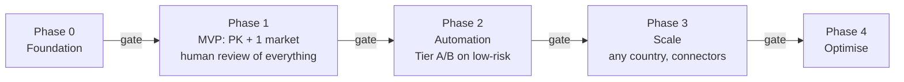

# AZINCO — Project Requirements & Architecture Blueprint
## Part 5 — Roadmap and First Milestone (Phase 0)

| Field | Value |
|---|---|
| Document | AZINCO Blueprint, Part 5 of 5 |
| Version | 0.1 (DRAFT — awaiting owner approval) |
| Date | 2026-11-17 |
| Sources | Base Standard (BS) §15, §8.8, §7.4, §7.8, §13, §16, App. A; Project Instructions (PI) §12; Parts 1–4 |
| Owner decisions applied | DEC-12 base currency PKR. Pending: DEC-01 (first international market — UK recommended), DEC-11 (auth — option (a) FastAPI-native assumed), DEC-13 (named Reviewer of Record) |
| Labels | **[Source]** · **[PI]** · **[Recommended]** |

> No dates are promised. Each phase ends only when its **exit gate** passes: golden-set accuracy targets met, Reviewer of Record sign-off, security review [Source BS §15]. Nothing in this roadmap is production-ready until the Phase 1 gate (at the earliest) and a go-live decision.

---

## 5.1 Phase overview

| Phase | Focus [Source BS §15] | Agents introduced | Exit output |
|---|---|---|---|
| 0 Foundation | Legal/licensing review, rule-pack governance, data model, security baseline, ADRs; [Recommended] audit log, tenant isolation, auth/RBAC, CI | none (Gateway + graph skeleton with [MOCK] provider only) | Approved scope, delivery modes per jurisdiction, ADRs, running secure skeleton |
| 1 MVP | Onboarding, tasks, uploads, advance payment (Banking Channels + 1 gateway, sandbox), ingestion, categorisation, reconciliation, Reviewer dashboard | Orchestrator, Ingestion, Validation, Categorisation, Posting, Reconciliation, QA Critic (+ Billing & Escrow as deterministic state-machine service) [BS §8.8, AMB-01/02] | Working end-to-end flow, human review of everything |
| 2 Automation | Tax & reporting agents, confidence policy, calibration engine, Tier A/B on low-risk | Compliance & Tax, Reporting, Knowledge/RAG; Billing & Escrow as full agent | Tier A/B on low-risk work, full deliverable set |
| 3 Scale | Jurisdiction onboarding for any country, comms, anomaly, connectors, analytics | Intake & Onboarding (agentic), Communication, Anomaly & Risk | Multi-region operation |
| 4 Optimise | Tenant-level learning, cost optimisation, forecasting, advisory | (enhancements) | Higher straight-through rate, new services |

The Audit & Logging Service (component 15) is built in Phase 0 and used by everything after [PI §12, AMB-03].

---

## 5.2 Phase 0 — Foundation

**Objectives:** settle what may legally be offered where; lock architecture decisions; build a secure, tested skeleton on which no feature can bypass tenancy, RBAC or audit.

| Area | Content |
|---|---|
| Features | Repo + Docker Compose; FastAPI and Next.js skeletons; PostgreSQL + Alembic; RLS tenant isolation; auth (Argon2id + TOTP MFA + server sessions); RBAC; append-only hash-chained audit log; Ledger Service skeleton with DB invariants (no agent access yet); Rule-engine package skeleton (empty packs + schema + test harness); Model Gateway interface with [MOCK] provider; CI pipeline |
| Non-code work | Legal/licensing review per jurisdiction (GAP-LEG-01); delivery mode per jurisdiction (DEC-02); rule-pack governance procedure; golden-set programme plan (GAP-AGT-02); ADR-001…013 written; threat model; data-retention draft |
| Dependencies | Owner: DEC-01, DEC-11, DEC-13; counsel availability; GitHub repo |
| Agent implementation order | None. Only `gateway` interface + `MockProvider`, and a 2-node LangGraph "hello graph" proving checkpoint + interrupt/resume |
| Testing | Unit (pytest, vitest); property tests (Hypothesis) on money and ledger invariants; integration tests with real Postgres/Redis/MinIO in CI; RLS isolation suite; auth/RBAC tests; audit hash-chain verifier test |
| Security checks | Secrets scan (gitleaks); dependency audit (pip-audit, npm audit); SAST (bandit, eslint security rules); container scan (trivy); threat model (STRIDE) reviewed; MFA enforced for staff roles; DB roles have no BYPASSRLS |
| Acceptance criteria | (1) `docker compose up` brings all services healthy; (2) CI green on all gates; (3) isolation suite proves tenant A cannot read/write tenant B on every tenant table; (4) unbalanced journal and update of posted journal are rejected **by the database**; (5) every API mutation produces an audit event and the chain verifies; (6) ADRs approved; (7) delivery-mode matrix + legal review recorded; (8) Reviewer of Record named and licence recorded; (9) security review signed. Golden-set criterion for P0 = golden-set **framework** and first synthetic set exist (no accuracy target yet) |
| Deliverables | Repo, compose stack, CI, ADRs, threat model, governance docs, delivery-mode matrix, golden-set plan, Phase 0 security review |

## 5.3 Phase 1 — MVP (Pakistan + one international market, recommended UK)

| Area | Content |
|---|---|
| Objectives | First end-to-end paid task with human review of **every** item [BS §8.8] |
| Features | Onboarding wizard + KYC upload + acceptance record; engagement letter + e-sign; opening balances; task, quote, checklist; uploads (drag-drop) with ClamAV; task state machine; Banking Channels adapter + one international gateway (**[SANDBOX]**), signed idempotent webhooks, daily settlement rec; extraction with evidence links; validation & dedup; categorisation (tenant rules first); draft journals → human approval → posting; bank reconciliation; QA Critic; Reviewer dashboard (queue, side-by-side, actions, four-eyes, licence check); GL/TB/bank-rec deliverables locked until settlement; Admin: portfolio, finance matrix, provider config, rule-pack manager (PK + UK packs, **Provisional**), agent ops basic; audit explorer basic |
| Dependencies | Phase 0 gate; Reviewer-sourced PK + UK pack content (GAP-TAX-01/02) for CoA mapping and tax codes; OCR decision (ADR-010); sandbox merchant accounts (GAP-PAY-05); synthetic golden set for PK & UK |
| Agent order | 1 Orchestrator graph → 2 Ingestion → 3 Validation & Dedup → 4 Categorisation → 5 Posting (drafts only) → 6 Reconciliation → 7 QA Critic. Billing & Escrow implemented as deterministic state-machine service + webhook handler |
| Technical tasks | OCR spike; Gateway real providers + failover; evidence-link mapper; matching engine; review bundle API; SSE progress; payment adapter; scheduler jobs |
| Testing | Golden set per doc type/language (EN + Urdu where available); E2E Playwright: register → onboard → pay advance (mock/sandbox) → upload → review → approve → pay balance → download; property tests on ledger posting & reversal; webhook replay tests; prompt-injection document tests |
| Security checks | Pen test of auth, RLS, uploads, signed URLs, webhooks; PII masking verified in logs and prompts; agent tool allow-lists verified; kill switch drill |
| Acceptance criteria | Extraction field accuracy ≥ 98% on clean synthetic golden set [BS §13]; 100% of journal lines have evidence links; 0 unbalanced/edited-posted entries possible; every approval has reviewer name + licence status + time; deliverables never downloadable before settlement (tested); Reviewer of Record sign-off on a full pilot task; security review passed |
| Deliverables | MVP running in staging with [SANDBOX] payments; pilot report; golden-set results |

## 5.4 Phase 2 — Automation

| Area | Content |
|---|---|
| Objectives | Tax & full reporting; measured, calibrated autonomy on low-risk work |
| Features | Compliance & Tax agent + rule engine computations with citations; Reporting (P&L, BS, CF, ageing, management summary, tax record pack); Knowledge/RAG over approved sources; confidence policy at 5 levels; calibration engine (collect → measure → calibrate → propose → shadow → approve → monitor); Tier A/B enabled for low-risk segments meeting N_min; auto-tighten; other reconciliations; fixed assets/inventory/payroll journals; email-in & camera upload; payment models 2 & 3; archive/export |
| Dependencies | Phase 1 gate; ≥ N_min (200) reviewed items per segment [BS §7.4]; Active-ready packs with sourced content |
| Agent order | Knowledge/RAG → Compliance & Tax → Reporting → Billing & Escrow (agentic wrapper) |
| Testing | Rule-level tests for every pack rule; property tests on tax/FX/depreciation calculators; calibration back-tests; shadow-mode comparison before any loosening |
| Security checks | RAG source allow-list; citation coverage audit; model/prompt change control evidence; DR restore test against RTO 4h / RPO 15m |
| Acceptance criteria | Tax outputs 100% with rule version + citation; calibration gap within target per segment; Tier D never auto; post-delivery error rate < 1% in pilot [BS §13]; Reviewer approves each threshold change; security review |
| Deliverables | Automated low-risk pipeline, calibration dashboards, full deliverables |

## 5.5 Phase 3 — Scale

| Area | Content |
|---|---|
| Objectives | Any-country onboarding; operational scale |
| Features | Jurisdiction Onboarding Protocol end-to-end (US, CA, AU packs, then on demand); multi-country tenants; Communication agent (EN/UR, approval for sensitive); Anomaly & Risk agent; bank & accounting-software connectors; analytics; Mode C partner co-sign; tax notices & amendments; multi-entity consolidation |
| Agent order | Intake & Onboarding (agentic) → Communication → Anomaly & Risk |
| Testing / security | Per-pack golden sets; connector contract tests; AML scenario tests; data-residency tests |
| Acceptance | New pack Provisional → Active only after accuracy targets; per-region turnaround targets met; security review |

## 5.6 Phase 4 — Optimise

| Area | Content |
|---|---|
| Objectives | Higher straight-through rate, lower cost, advisory revenue |
| Features | Tenant-level learning from approved corrections; model cost routing; forecasting; advisory reports |
| Acceptance | Measured gains vs baseline without quality regression; security review |

---

## 5.7 First implementation milestone — Phase 0, step by step

Each step = one response with objective, requirements (§), folder structure, complete code, commands, tests and expected results [PI §14]. Steps are small enough to review and commit separately.

| Step | Title | Main outputs | Done when |
|---|---|---|---|
| 0.1 | Repo structure & conventions | Monorepo folders, `README`, `.gitignore`, `.editorconfig`, `.env.example`, `docs/` with blueprint + ADR template, pre-commit (ruff, mypy, prettier, gitleaks), `git init` | `pre-commit run --all-files` passes; no secrets in tree |
| 0.2 | Docker Compose stack | `infra/docker/compose.yml`: postgres(pgvector pg16), redis, minio, clamav, mailpit; healthchecks; init SQL creating DB roles | `docker compose up -d` → all healthy |
| 0.3 | FastAPI skeleton | `services/api` (Pydantic settings, structlog JSON, error handler, `/health`, `/ready`), Dockerfile, pytest | `/ready` checks DB, Redis, MinIO; tests pass; mypy strict clean |
| 0.4 | Next.js skeleton | `apps/web` App Router, strict TS, Tailwind, route groups, typed API client stub, Zod, vitest, Playwright config | `npm run build` + tests pass; page shows API health |
| 0.5 | PostgreSQL + Alembic + money | Alembic setup, `migrator` vs `app` roles, `Money` type (Decimal, NUMERIC(20,4)), first migration (tenants, users, memberships) | upgrade/downgrade clean; Hypothesis tests on Money |
| 0.6 | Tenant isolation (RLS) | RLS + FORCE on tenant tables, `SET LOCAL` session dependency, isolation test suite | Cross-tenant read/write tests fail closed |
| 0.7 | Auth & RBAC | Register/login/logout, Argon2id, TOTP MFA, DB sessions, httpOnly cookie + CSRF, permission matrix, MFA enforced for staff | Auth + RBAC test matrix green |
| 0.8 | Audit log | `audit` schema, INSERT-only role, hash chain, same-transaction writer, verifier job, `/audit/events` | Tamper test detected; every mutation audited |
| 0.9 | Ledger Service skeleton | `services/ledger`, `ledger` schema, journals/lines/periods, deferred balance trigger, immutability & period triggers, draft/post/reverse internal API (human-approval token required to post) | Property tests: no unbalanced or edited-posted journal persists |
| 0.10 | Rule engine & Gateway skeletons | `packages/rule-engine` (pack schema, loader, pure evaluator, empty packs), `gateway` interface + [MOCK] provider, LangGraph 2-node graph with Postgres checkpointer + interrupt/resume | Unit tests pass; graph resumes after simulated crash |
| 0.11 | CI pipeline | GitHub Actions: lint, typecheck, unit/property, integration (services), isolation suite, security scans, migration check, image build | Green on PR; branch protection documented |
| 0.12 | Phase 0 governance pack | ADR-001…013, threat model, delivery-mode matrix template, rule-pack governance SOP, golden-set plan, Phase 0 security checklist | Owner + Reviewer sign-off recorded |

### Phase 0 Definition of Done
1. All 12 steps merged to `main` with CI green.
2. Local stack starts with one command; README explains setup on Windows (Docker Desktop + WSL2) and Linux.
3. Tenant isolation, DB-level ledger invariants, audit hash chain and RBAC each proven by automated tests.
4. No secrets committed (gitleaks clean); `.env.example` only placeholders.
5. Everything mocked is labelled **[MOCK]**; nothing claims production readiness.
6. ADRs approved; DEC-01, DEC-02 (draft), DEC-11, DEC-13 recorded.
7. Phase 0 security review completed and signed.
8. Blueprint Parts 1–5 and ADRs saved in `docs/` and as project docs.

### What Phase 0 deliberately does NOT include
No real OCR, no real LLM calls in tests, no real payment providers, no tax rule content, no client-facing features beyond auth — these start in Phase 1 after the gate.

---

## 5.8 Tooling note — Playwright MCP [Recommended]
Playwright MCP (`@playwright/mcp`) is configured on the developer machine for exploratory UI checks against `localhost` only, with synthetic data. Repository E2E tests use `@playwright/test` in `tests/e2e` and run in CI independently of MCP.

---

## Part 5 — Summary of coverage

| # | Item | Status | Notes |
|---|---|---|---|
| 5.1 | Phase overview | Done | 5 phases, gate between each |
| 5.2 | Phase 0 | Done | Objectives, features, deps, testing, security, acceptance, deliverables |
| 5.3 | Phase 1 | Done | Agent order per BS §8.8 |
| 5.4 | Phase 2 | Done | Calibration, Tier A/B |
| 5.5 | Phase 3 | Done | Any-country onboarding |
| 5.6 | Phase 4 | Done | Optimise |
| 5.7 | First milestone | Done | 12 steps + Definition of Done |
| 5.8 | Playwright MCP note | Done | localhost + synthetic only |
